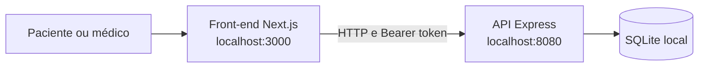

# MedGuide

Aplicação web para conectar pacientes e profissionais de saúde. O repositório reúne a interface Next.js e a API REST Express em dois projetos independentes, executados em conjunto no desenvolvimento local.

## Arquitetura



| Pasta | Responsabilidade | Tecnologias |
| --- | --- | --- |
| [`medguide_front/`](medguide_front/README.md) | Interface, formulários, painéis, busca e navegação por perfil | Next.js 16, React 19, TypeScript, Tailwind CSS 4 |
| [`Medguide/`](Medguide/README.md) | Autenticação, perfis, consultas, dados clínicos e API REST | Node.js, Express, TypeScript, JWT, SQLite |

## Requisitos

- Node.js e npm instalados. Node.js 20 LTS é a versão recomendada para desenvolvimento; confira também os requisitos declarados nos `package.json`.
- Portas locais `3000` para o front-end e `8080` para a API.
- Execute cada projeto em um terminal próprio.

## Configurar e executar

### API

```powershell
Set-Location .\Medguide
npm ci
Copy-Item .env.example .env
```

Defina um `JWT_SECRET` privado com pelo menos 32 caracteres em `Medguide/.env`. Para gerar um valor aleatório:

```powershell
node -e "console.log(require('crypto').randomBytes(32).toString('hex'))"
```

Para uso local, configure `DATABASE_PATH=./database.sqlite` e `FRONTEND_ORIGIN=http://localhost:3000`. Inicie a API:

```powershell
npm run dev
```

A API escuta na porta `8080`. Acesse `http://localhost:8080/api/health` para verificar sua disponibilidade.

### Front-end

Em outro terminal, a partir da raiz do repositório:

```powershell
Set-Location .\medguide_front
npm ci
Copy-Item .env.example .env.local
```

Configure `medguide_front/.env.local`:

```dotenv
NEXTAUTH_URL=http://localhost:3000
NEXTAUTH_SECRET=segredo-aleatorio-privado
NEXT_PUBLIC_API_URL=http://localhost:8080
```

Inicie o cliente:

```powershell
npm run dev
```

Abra `http://localhost:3000`. Se o Next.js iniciar em outra porta, atualize `FRONTEND_ORIGIN` na configuração da API e reinicie o serviço.

## Fluxos principais

- Cadastro, login e perfis separados para pacientes e médicos.
- Busca de profissionais por nome e especialidade.
- Agendamento e consulta de atendimentos.
- Painel médico para alterar o estado da consulta e registrar dados clínicos e medicamentos.
- Painel do paciente para visualizar consultas, prescrições e registrar confirmação de doses.

O front-end chama a API em `${NEXT_PUBLIC_API_URL}/api`. Para operações autenticadas, envia o JWT no cabeçalho `Authorization: Bearer <token>`. A sessão NextAuth também existe no cliente, portanto as duas partes da autenticação precisam seguir os fluxos já implementados em cada página e serviço.

Rotas mais usadas:

| Operação | Caminhos |
| --- | --- |
| Saúde | `GET /api/health` |
| Paciente | `POST /api/pacient/register`, `POST /api/pacient/login`, `GET/PUT /api/pacient/profile` |
| Médico | `POST /api/doctor/register`, `POST /api/doctor/login`, `GET/PUT /api/doctor/profile` |
| Busca | `GET /api/doctor/search`, `GET /api/doctor/specialties` |
| Consultas | `POST /api/appointments`, `GET /api/appointments/pacient/:patientId`, `GET /api/appointments/doctor/:doctorId`, `PUT/DELETE /api/appointments/:id` |
| Doses | `GET/POST /api/appointments/:id/medications/doses` |

## Scripts de validação

Execute cada comando dentro da pasta do respectivo projeto.

```powershell
# API
npm run build
npm start

# Front-end
npm run lint
npm run build
npm start
```

O script `npm test` da API ainda é um placeholder e não executa testes automatizados. A documentação técnica existente está em `medguide_front/docs/entrega-bloco-03.md`.

## Segurança e dados locais

Os arquivos `.env`, `.env.local`, tokens e bancos SQLite locais não devem ser versionados. Use dados fictícios nos ambientes de demonstração. Para publicação, configure origens e segredos próprios do ambiente e revise autorização, armazenamento persistente e backups.
