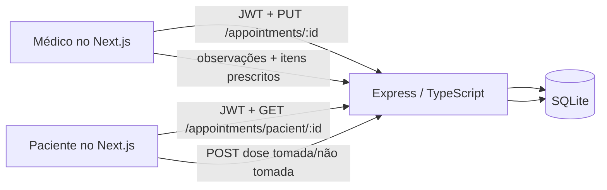

# MedGuide — Entrega do Bloco 03

**Escopo:** integração entre front-end e back-end, registro clínico do atendimento, prescrição estruturada, lembretes e confirmação de doses, revisão responsiva, cenários de validação e documentação para handoff.

## 1. Arquitetura e implementação



- **Front-end:** Next.js App Router, React, TypeScript e Tailwind. O médico edita diagnóstico, orientações, observações e uma lista de medicamentos no modal de atendimento.
- **Back-end:** Express com JWT. A API valida o perfil e o vínculo da pessoa com a consulta antes de exibir ou alterar dados clínicos.
- **Persistência:** a tabela `Appointment` guarda `prescription_details` como JSON; `MedicationDoseLog` guarda a confirmação (tomou/não tomou) para cada consulta, medicamento, data e horário.
- **Contrato da prescrição:** cada item contém `id`, `name`, `dosage`, `times[]`, `start_date` e `duration_days`. A API valida nome, dose, horários, duração de 1 a 365 dias e data inicial.
- **Doses:** `GET /api/appointments/:id/medications/doses` lista registros; `POST` recebe `{ medication_id, scheduled_at, taken }`. A consulta precisa pertencer ao paciente autenticado. A API confere se a dose e a data fazem parte do plano.
- **Lembretes:** o navegador mostra uma notificação local no horário configurado quando o paciente concedeu permissão. O painel também mostra as ações de confirmação. A página precisa continuar aberta; não há push em segundo plano, SMS ou e-mail.

### Fluxo principal

1. O médico abre uma consulta aceita ou realizada e escolhe **Registrar atendimento** ou **Editar atendimento**.
2. Preenche observações e adiciona medicamento, dose, horários, início e duração.
3. O front envia a atualização autenticada. A API confirma que o token é de médico e que ele é o profissional vinculado à consulta.
4. A consulta do paciente recebe a prescrição e apresenta os horários; a confirmação da dose fica registrada na API.

## 2. Configuração e reprodução

Requisitos: Node.js compatível com Next.js 16, npm e portas locais 3000 e 8080 disponíveis.

### Back-end — terminal 1

```powershell
cd "C:\Users\psilv\OneDrive\Área de Trabalho\ux\Medguide"
npm ci
Copy-Item .env.example .env
node -e "console.log(require('crypto').randomBytes(32).toString('base64url'))"
```

Copie o valor gerado para `JWT_SECRET` em `.env`. Mantenha `.env` privado. `DATABASE_PATH=./database.sqlite` cria o banco local; `FRONTEND_ORIGIN` aceita uma origem publicada adicional, se necessário.

```powershell
npm run dev
```

A API fica em `http://localhost:8080`; `GET /api/health` verifica a disponibilidade.

### Front-end — terminal 2

```powershell
cd "C:\Users\psilv\OneDrive\Área de Trabalho\ux\medguide_front"
npm ci
Copy-Item .env.example .env.local
```

Defina `NEXTAUTH_SECRET` aleatório em `.env.local` e confirme `NEXTAUTH_URL=http://localhost:3000` e `NEXT_PUBLIC_API_URL=http://localhost:8080`.

```powershell
npm run dev
```

Abra `http://localhost:3000`. Se a porta 3000 estiver ocupada, o Next pode usar 3001; o back-end já libera essa origem. Evite iniciar uma segunda instância na mesma pasta enquanto o arquivo `.next/dev/lock` estiver ocupado.

### Comandos de validação

```powershell
# Back-end
npm run build

# Front-end
npx tsc --noEmit
npm run lint
npm run build
```

Execute cada comando no terminal da pasta do respectivo projeto. O `npm test` do back-end ainda é apenas um placeholder, portanto os cenários abaixo foram executados manualmente contra a API local.

## 3. Cenários e resultados de validação

| ID | Cenário | Resultado observado |
| --- | --- | --- |
| API-01 | GET `/api/health` com a API iniciada | A API responde e informa estado/horário. |
| API-02 | Registrar e autenticar um paciente de QA | A API criou o perfil e emitiu JWT. |
| API-03 | Registrar e autenticar um médico de QA | A API criou o perfil e emitiu JWT. |
| API-04 | Paciente criar consulta usando o médico existente | HTTP 201; consulta retornada com UUID próprio. |
| API-05 | Paciente listar consultas em `/appointments/pacient/:id` | Consulta retornada; caminho alinhado ao serviço do front. |
| API-06 | Médico salvar diagnóstico, observações e prescrição estruturada | Atualização retornou todos os campos e itens de medicamento. |
| API-07 | Paciente ler a prescrição e registrar dose tomada | A dose foi gravada; `GET .../medications/doses` retornou o registro. |
| API-08 | Inicialização em banco SQLite local novo | As tabelas principais, a coluna nova e a tabela de doses foram criadas. |
| API-09 | Consultar confirmação de dose sem token | API respondeu HTTP 401. |
| API-10 | Preflight CORS da origem `http://localhost:3001` | API retornou `Access-Control-Allow-Origin` para a origem solicitada. |
| UI-01 | Entrar com perfil sintético de paciente e abrir consultas | A consulta e o plano de medicamento apareceram no painel. |
| UI-02 | Abrir editor do médico e revisar prescrição existente | Campos de diagnóstico, observações, dose, duração e horários foram apresentados. |
| UI-03 | Revisar formulário e painel em viewport móvel (390 px) | Conteúdo adaptou-se à largura; editor e controles de dose permaneceram acessíveis. |
| BUILD-01 | Compilação TypeScript do back-end | Aprovado. |
| BUILD-02 | TypeScript e build de produção do front-end | Aprovados. |
| LINT-01 | ESLint do front-end | Aprovado, sem erros ou avisos após a revisão final. |

Os cadastros e a consulta usados na demonstração eram registros sintéticos locais e foram removidos da base após a validação. Não foi usado dado de paciente real.

### Evidências

As capturas usadas na revisão são mantidas fora deste repositório público porque exibem identificadores e dados clínicos de demonstração. Os cenários e resultados registrados nesta documentação devem ser repetidos no ambiente de entrega.

## 4. Revisão de interface e responsividade

- Ajustei as quatro abas de status do painel médico para uma grade de duas colunas em celular e quatro opções em telas maiores.
- Empilhei o seletor de seção no celular e mantive as ações com largura mínima controlada para evitar rolagem horizontal.
- Elevei os modais acima da navegação inferior móvel para manter campos, botões de salvar e fechar acessíveis.
- Revisei os formulários para usar campos em uma coluna no celular e duas colunas quando há largura suficiente.
- Os botões de dose são mostrados para horários já alcançados; horários posteriores aparecem como programados.
- O botão de notificações solicita permissão somente após clique; a recusa não impede ver o plano nem registrar doses.

## 5. Design Handoff Package

### Componentes e estados

| Componente | Responsabilidade | Estados principais |
| --- | --- | --- |
| `ClinicalRecordModal` | Diagnóstico, orientação, observação e lista de medicamentos | Novo, editar, enviando, erro, salvo |
| `MedicationPlanCard` | Plano diário, notificação e confirmação da dose | Programado, aguardando, tomado, não tomado, erro |
| `AppointmentCard` | Histórico de consulta do paciente | Agendada, confirmada, realizada, cancelada |
| `MobileBottomNav` | Navegação rápida do paciente/médico | Papel autenticado e item atual |

### Regras de conteúdo e comportamento

- Nome e dosagem são obrigatórios por medicamento. Um item pode ter mais de um horário; cada horário exige `HH:mm`.
- Início e duração definem os dias em que o plano fica ativo. A API rejeita duração fora de 1–365 dias e confirmações fora dos horários/datas prescritos.
- A resposta “Não tomei” é um registro de adesão daquele horário, não altera o tratamento ou o plano médico.
- As observações permanecem como texto livre com limite de 5.000 caracteres no servidor.
- Em telas pequenas, controles podem quebrar para uma segunda linha; não reduza os alvos de toque abaixo dos estilos atuais de botão.

### Referências de implementação

- Formulário do médico: `src/components/ClinicalRecordModal.tsx`.
- Plano e confirmações: `src/components/MedicationPlanCard.tsx`.
- Serviços do front: `src/app/lib/service/appointmentService.ts`.
- Consulta do paciente: `src/app/pacient/dashboard/page.tsx` e `src/app/pacient/medicamentos/page.tsx`.
- API e persistência: `src/controllers/AppointmentController.ts`, `src/routes/AppointmentRoutes.ts`, `src/models/AppointmentModel.ts` e `src/database/init.ts` no back-end.

## 6. Limites e próximos passos

- Não existe suíte automatizada de testes no projeto; adicionar testes de API automatizados é o próximo passo recomendado.
- Notificações precisam de aba/página aberta. Para funcionamento confiável em segundo plano, falta service worker com Web Push e gestão de inscrições.
- O status/tipo de usuário é conferido nos endpoints de consulta, edição e confirmação; revise também as demais rotas antigas do back-end antes de publicar dados reais.
- A API está configurada para origem local. Inclua o domínio real do front em `FRONTEND_ORIGIN` no ambiente publicado.
- O back-end declara suporte oficial a Node 18 ou 20; a máquina de desenvolvimento usa Node 24 e emite aviso de versão durante o `npm ci`.
